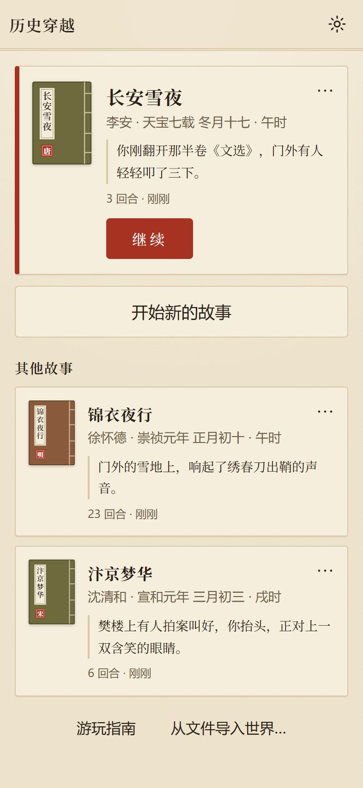
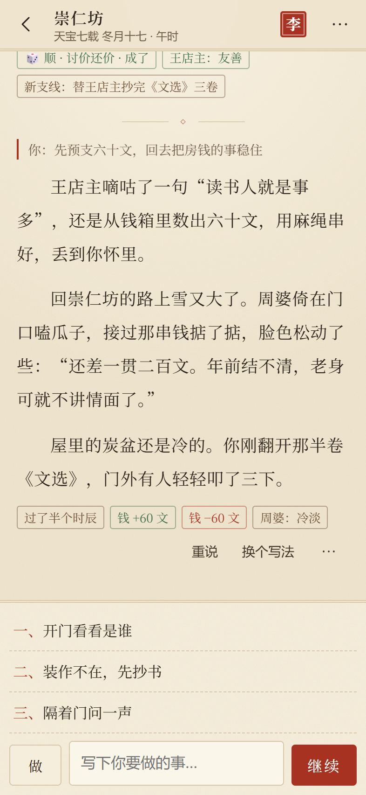
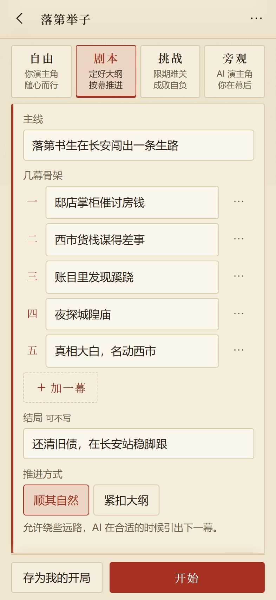
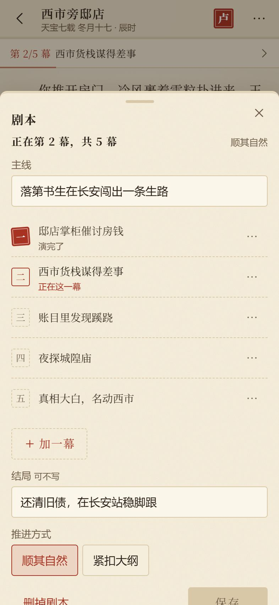

# 历史穿越

**装在手机里的 AI 互动小说：写下开头，成为主角，用一句话决定接下来做什么，AI 把故事接着写下去。**

穿越到唐宋明清，也可以去仙侠、奇幻、科幻，或者你喜欢的作品里的世界。

安卓 7.0 及以上 · Windows 10 / 11 · 需要你自己的 AI 服务

[下载](https://github.com/wangyingxuan383-ai/lishi-chuanyue/releases) · [更新记录](CHANGELOG.md) · [反馈问题](https://github.com/wangyingxuan383-ai/lishi-chuanyue/issues)

   

> 这是作者个人长期开发的项目，现在还是预发布阶段：功能变化快，也还没在很多手机上试过。遇到问题欢迎[反馈](#反馈)。

## 能做什么

- **自己定开头**：名字、身份、处境和故事设定都由你写；写一句话让 AI 补全，或者从灵感里挑一个再改；也可以“随便穿”，马上开始。
- **历史穿越**：年号纪年和农历，过年长一岁，物价和称谓跟着时代走。天下大事年表只给你看；你改变了历史，故事会记下这一世的“历史偏离”。
- **自由世界**：仙侠、奇幻、科幻，或者作品里的世界。不套年号和史事，世界的设定由你来写。
- **参考书籍与同人**：导入 TXT、EPUB、文字 PDF 或 DOCX，用作世界资料，或从原著的一章附近开始同人故事。选择允许改写或尽量沿原剧情，自己写清“原著怎么用”；默认检索相关原文，也可主动让 AI 通读整理。书籍保存在本机，生成和整理时所需内容会发送给你选定的服务。扫描 PDF 暂不识别。
- **四种玩法**，开局时选，默认是自由：
  - **自由**：你来扮演主角，故事随你的行动展开。
  - **剧本**：先写下主线和几幕骨架（也可以让 AI 拟一份），AI 按幕推进，你照样自由行动。
  - **挑战**：开局定下一个目标和期限，比如“三个月内凑够三百两”，成败自负，结束时有结局卡。
  - **旁观**：主角交给 AI 演，你在幕后指点；“连播”能一口气看好几段。
- **几种写法**：做（写行动）、说（写台词）、写（亲手写一段剧情，AI 顺着往下写）、幕后（只告诉 AI 这段怎么写），或者什么都不写，直接点“继续”。
- **故事记得住**：钱、行囊、人物和他们对你的态度、时间和目标都由程序记账，角色面板里随时能看、能改；设定集记下地点、势力和物品；长按一段“记住这件事”；每隔一些回合自动写成一章摘要。
- **随时回头**：不满意就重说，几个版本都留着；撤销、重做；从任意一段“回到这里”另走一条路，世界线和回合树里能看到所有岔路。AI 改写段落之前先给你看改稿，原文随时能恢复。
- **读着舒服**：纸张、白天、夜间三套主题，宋体或黑体，字号和行距可调；目录、全文搜索、前情提要；整局能导出成小说，一段文字能做成书摘卡。
- **还有**：过些日子（快进一段时光）、查一查（问这个世界里的人和事）、可开可关的运势、三档难度。电脑上把窗口拉宽是双栏布局，有快捷键。

## 下载安装

到 [Releases](https://github.com/wangyingxuan383-ai/lishi-chuanyue/releases) 下载最新的版本。

### 安卓

1. 用手机浏览器下载 `chuanyue-<版本>.apk`（安卓 7.0 及以上、64 位 ARM 处理器，近几年的手机基本都是）。
2. 点开安装。第一次安装时，系统会请你允许浏览器或文件管理“安装未知应用”。
3. 已经装过旧版的，直接安装新版，提示“更新”就对了。**不要先卸载**：卸载会删掉手机里所有的世界。如果提示签名不一致，或者与已安装的应用冲突，请停下来，不要卸载，到 [Issues](https://github.com/wangyingxuan383-ai/lishi-chuanyue/issues) 说一声。

**提示“安装包无效”或“解析包时出现问题”？** 多半是网络不稳，浏览器把安装包下坏了：文件大小看着没错，中间却缺了一段。重新下载一次就好。想确认的话，Releases 页上每个文件旁边都有 SHA-256，发布里也附了 `SHA256SUMS.txt`。

从 0.10.0 起，安卓版可以在“设置 → 关于与更新”里直接下载新版：断点续传，校验无误才安装，下坏的文件会被删掉，再下一次即可。从更早的版本升到 0.10.0，还需要手动下载一次。

### Windows

- **安装包** `chuanyue-<版本>-windows-x64-setup.exe`：只装给当前用户，不需要管理员。升级时直接运行新的安装包覆盖安装。
- **免安装版** `chuanyue-<版本>-windows-x64-portable.zip`：解压后双击 `lishi-app.exe`。它和安装版共用同一份存档（在 `%APPDATA%\io.timejump.chuanyue`）。
- 程序没有代码签名，第一次运行时 Windows 可能提示“已保护你的电脑”，点“更多信息 → 仍要运行”。需要 WebView2，Windows 10、11 一般已经自带。
- 卸载时不勾“删除应用程序数据”，世界就不会被删掉。Windows 版检查到新版本时会打开发布页，由浏览器下载。

### 备份与换设备

每天第一次打开时自动备份一次。重要的世界可以在首页点它的“⋯”导出成文件，换手机或电脑时用“从文件导入世界…”导入。

## 连接 AI 服务

应用本身不带 AI，需要你自己的服务和 Key：兼容 OpenAI 接口的服务都可以。内置了 DeepSeek、硅基流动、智谱、通义千问、Kimi、火山方舟、OpenRouter 和 Gemini 的预设，每家都附了“申请 Key · 价格”的链接；用中转服务的，选“自定义”填地址。

第一次打开时选服务商、填 Key，模型列表会自己出来；写故事和整理资料可以各选一个模型，整理用便宜快的就够了。海外的服务连不上时，可以在“设置 → 网络与代理”里设代理。

- **Key 存在哪里**：手机或电脑系统的加密存储里（安卓用 Keystore，Windows 用当前用户的加密），不进存档、导出文件和日志。
- **费用**：由你的服务商按用量收取，和本应用无关。“设置 → 用量与花费 → 用量明细”能按世界、按天看调用次数，填上单价可以估算花费，也能设本月预算提醒。这些都是估算，不是账单。

## 隐私

- 没有账户，应用不收集任何数据，存档都在你自己的设备上。
- 使用 AI 时，故事设定和需要的前文会发给你选的那家服务；那边怎样处理这些内容，取决于那家服务的规定。
- 除了你配置的 AI 服务，应用自己只会访问本仓库在 GitHub 上的发布页：打开时每天最多查一次有没有新版本（可以在设置里关掉），以及你点了“下载更新”之后下载安装包。这些请求不带账号，也不带 Key。服务商的申请和价格页面，是你点了才用浏览器打开的。

## 许可

本项目暂未授予开源许可：你可以查看代码、下载安装包自己使用；复制、修改或再发布，需要先取得作者的同意。

## 反馈

遇到问题或者有建议，请到 [Issues](https://github.com/wangyingxuan383-ai/lishi-chuanyue/issues) 提出来，应用里“设置 → 关于与更新 → 提交问题”也能打开这里。请写上应用的版本号、手机或电脑的型号和系统；**不要贴出你的 Key 或服务地址**。

## 开发者

界面用 React + TypeScript + Vite，外壳是 Tauri 2，存储、密钥、网络这些平台服务用 Rust 写；安卓优先，Windows 同步。怎样构建、在浏览器里调试、接本地模拟模型、跑测试和装到手机上，见[开发说明](docs/DEVELOPMENT.md)。
## 友链

学AI 上L站！ [L站链接](https://linux.do/)
