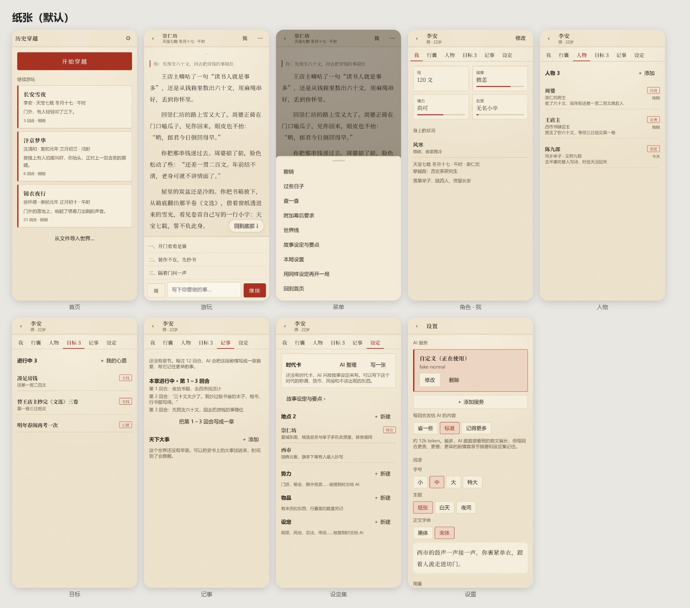

# AI 历史穿越模拟器

一个装在手机里的“AI 穿越小说 + 人生模拟”：你穿越到某个历史时代，成为某个具体的人，用自然语言决定怎么活；AI 把你的选择写成故事，程序替你记住世界的一切。

这是一个长期开发的个人项目，专注 Android 手机 App；Windows 用于开发调试；网页版评估后建议暂不做。仓库公开，但**还没有选定许可证**：可以阅读代码、下载安装包自己用，复制、修改或再发布代码需要先取得作者同意。

## 安装

到本仓库的 [Releases](https://github.com/wangyingxuan383-ai/lishi-chuanyue/releases) 下载：手机用 `chuanyue-<版本>.apk`（Android 7 及以上，ARM64），电脑用 `chuanyue-<版本>-windows-x64.zip`。装过旧版的直接覆盖安装，**不要先卸载**（卸载会删掉所有世界）。第一次打开时，在设置里填自己的 AI 服务（OpenAI 兼容接口）和 Key。详见[私人发行包](docs/RELEASE.md)。

## 当前阶段

**2026-10-17：v3 重构 · R02～R10 里不需要手机的工程都已完成，发布 0.8.0（预发布）。** 开局（作者模式）、流式回合、重说与世界线、角色面板、自定义优先的设定集、长局记忆（章节摘要、相关旧事、人物来历；150 回合评测记忆 94%）、过些日子、运势、天下大事、查一查、导出导入与备份、电脑宽屏、“宣纸书卷”的新样子都已做好，等手机上集中试玩与验收。v2 代码见标签 `legacy-v2-final`。

当前进度和下一步见[现场状态](docs/STATE.md)；任务完成情况只看[任务台账](docs/TASKS.md)。

## 文档导航

| 文档 | 用途 |
|---|---|
| [AGENTS.md](AGENTS.md) | AI 接手与持续开发协议（所有 AI 开始工作前必读） |
| [第三版计划](docs/PLAN_V3.md) | 当前唯一的产品与工程计划：诊断、体验设计、引擎、架构、阶段路线 |
| [任务台账](docs/TASKS.md) | 唯一的任务状态、依赖、验收与证据 |
| [现场状态](docs/STATE.md) | 现在在哪、下一步、注意事项 |
| [决策记录](docs/DECISIONS.md) | 重要取舍与理由 |
| [变更记录](CHANGELOG.md) | 实际发生的重要变化 |
| [开发说明](docs/DEVELOPMENT.md) | 工具、命令、手机连接 |
| [私人发行包](docs/RELEASE.md) | 版本号、构建签名、给手机安装 |
| [设计规范](docs/design/DESIGN_SPEC.md) | 选定的“宣纸书卷”样子：主题、字体、组件、动效、图标（候选方向的比较见[视觉方向](docs/design/VISUAL_DIRECTIONS.md)） |
| [海外产品调研](docs/research/COMPETITORS_INTL.md) | AI Dungeon、SillyTavern、Voyage 等 |
| [中文产品与题材调研](docs/research/COMPETITORS_CN.md) | 《崇祯》、太吾、星野、穿越题材、时代细节 |
| [试玩问卷模板](docs/validation/PLAYTEST_TEMPLATE.md) | 每阶段用户试玩验收 |
| [v2 归档](docs/archive/v2/PLAN_V2.md) | 第二版计划、台账、决策、验证记录（只读） |

[第一版报告](deep-research-report.md)保留为原始想法参考，不构成约束。

## 基本约定

- 用户自带 AI 服务（OpenAI 兼容接口）和 Key；Key 由手机/电脑的系统加密存储保存，不进入文档、存档、日志或 Git。
- 游戏存档保存在本机；无需账户。
- 开发文档（Markdown）是项目记忆；游戏数据（回合、人物、世界线）存在 SQLite 中，两者分开。
