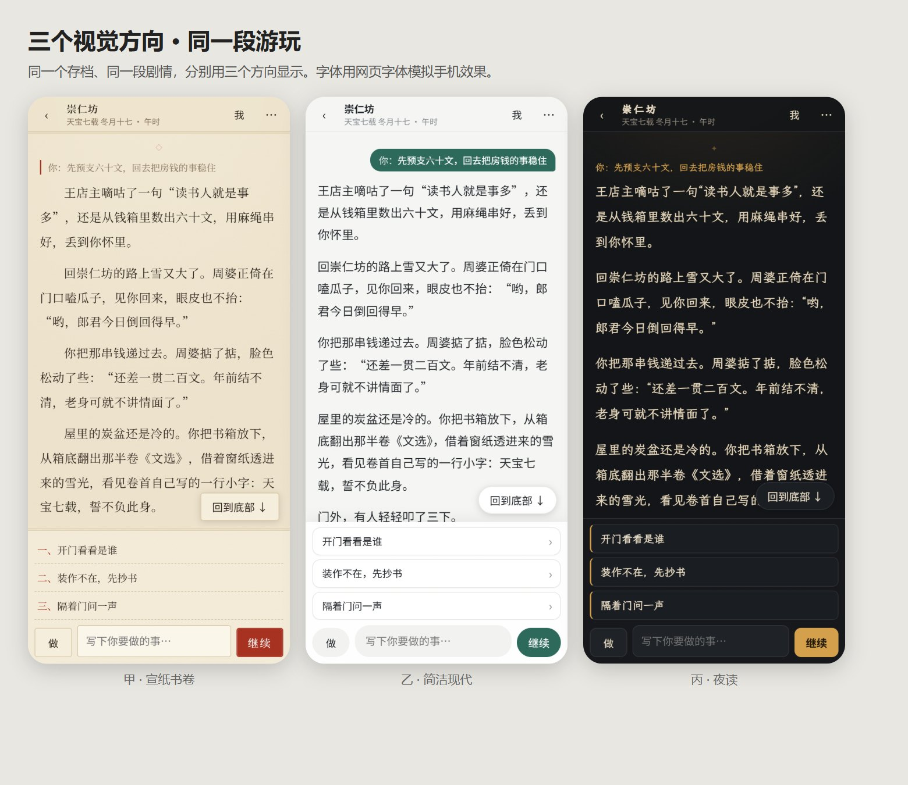
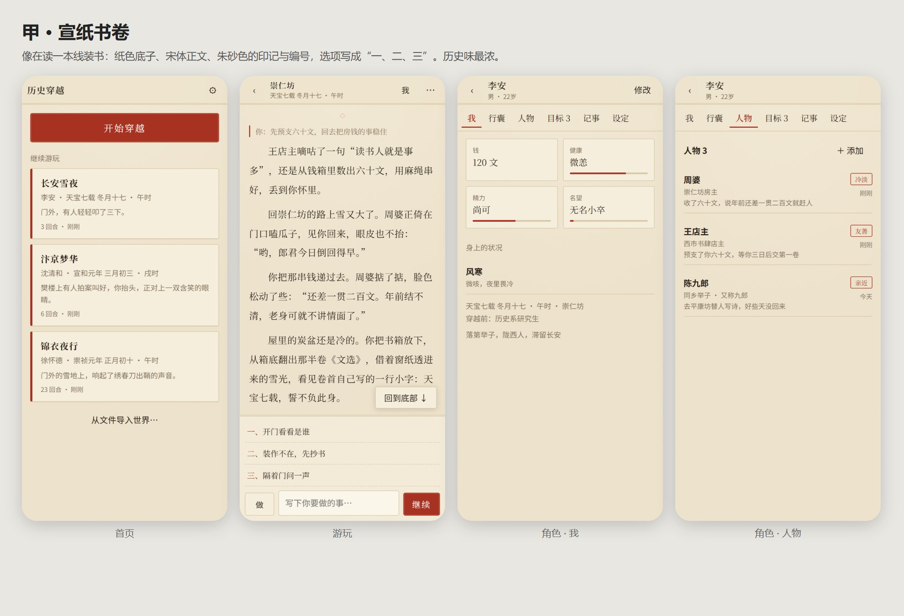
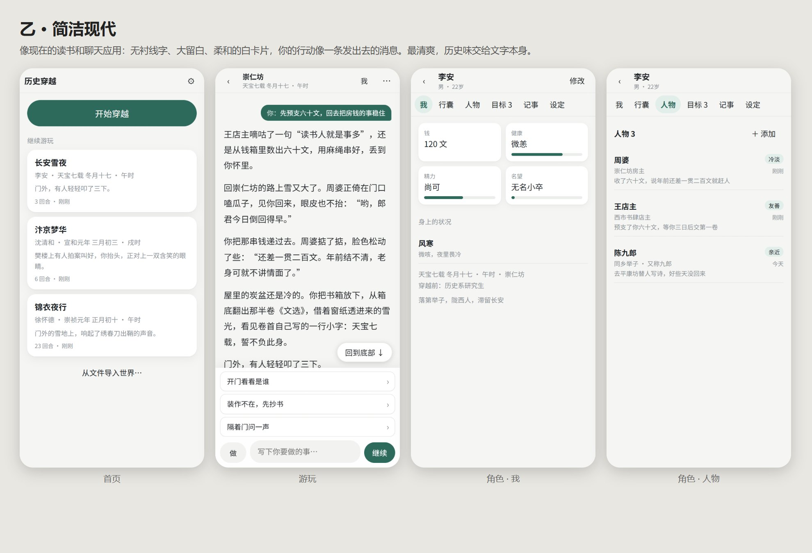
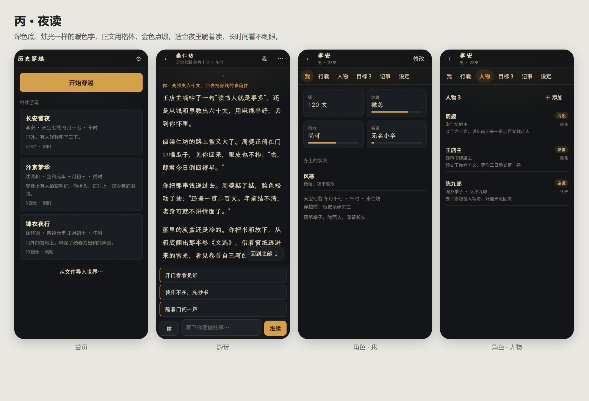
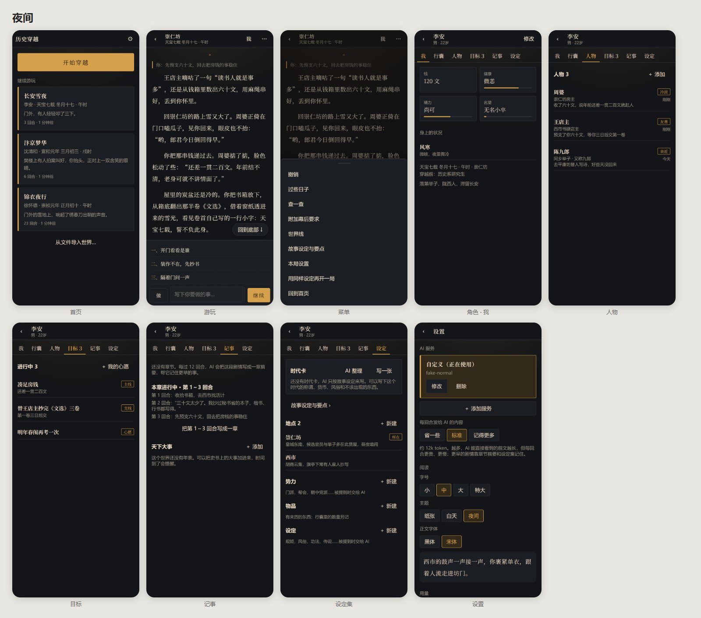
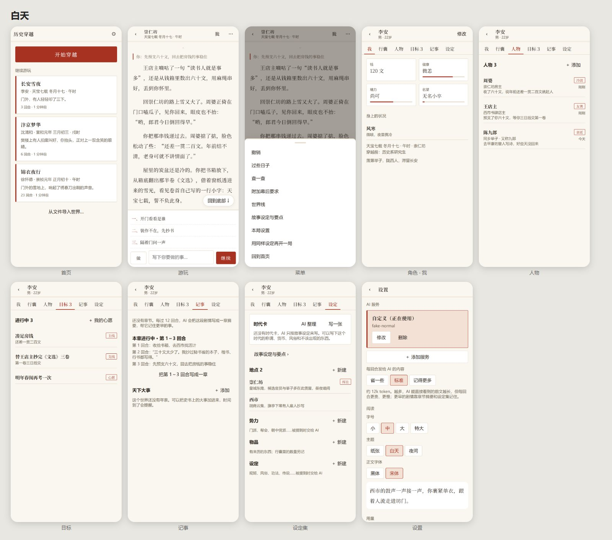
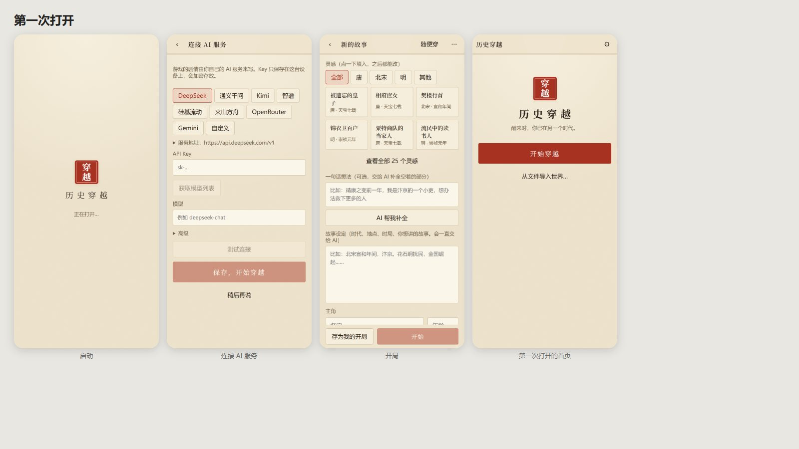

# 视觉方向（R09-T001）

> 2026-10-17 · **已定：甲为主，夜间用丙的配色**（用户让 Claude 自行决定，D125）。规范见[设计规范](DESIGN_SPEC.md)，重做后的全部界面见下面的[现在的样子](#现在的样子)。本页保留三个候选方向的原型截图，作为当时的比较记录。

三个方向用的是同一个存档、同一段剧情、同样的页面结构，只换了字体、颜色和装饰，方便对比“气质”。页面的布局细节（按钮位置、间距、动效）在 R09-T002 里还会整体打磨。

## 甲 · 宣纸书卷

- **样子**：米黄的纸色底子带一点纸纹，正文用宋体，每段首行空两格；朱砂红作点缀：变化标签像一枚枚小印，选项写成“一、二、三”，回合之间用一个小菱形隔开；标题下面是双线。
- **好处**：和历史穿越的题材最贴，打开就像在读一本书，有自己的辨识度。
- **代价**：装饰多一些，界面略“重”；要给它另配一套夜间版（墨色底、米色字）；宋体在手机上可能要随 App 附带字体（见下）。

## 乙 · 简洁现代

- **样子**：浅灰白底、白色卡片和柔和阴影，全部用黑体；你的行动像一条发出去的消息（右侧的绿色气泡），选项是带箭头的卡片；圆角大、留白多。
- **好处**：最清爽、最像成熟的读书和聊天应用，信息最清楚；不依赖特殊字体，在任何手机上效果都一样。
- **代价**：时代感几乎全靠文字本身，界面和别的 AI 聊天应用相似，辨识度最低。

## 丙 · 夜读

- **样子**：深色底，顶部有一点烛光般的暖色光晕；正文用楷体、暖米色字，金色点缀：你的行动是金色小字，选项左边一道金线，主按钮是金色。
- **好处**：夜里躺着读最舒服，长时间看不刺眼；楷体有书卷气又不呆板。
- **代价**：白天在强光下不如浅色清楚（可以白天切浅色版）；楷体需要随 App 附带字体。

## 不管选哪个都会有的

- 浅色、深色两套，跟着现在的“阅读设置”切换；字号设置照旧。
- 页面结构不变：故事流、底部的选项和输入框、右上角的“我”、⋯菜单。R09-T002 会在选定的方向上把所有页面（开局、设置、设定集、世界线等）统一重做，并补上图标、启动页和正式应用名。

## 字体（需要在手机上确认）

- 截图里用网页字体模拟手机效果：甲用思源宋体（Noto Serif SC），乙用思源黑体（Noto Sans SC），丙用霞鹜文楷（LXGW WenKai Screen）。三种都是开源字体（SIL OFL），可以随 App 发布。
- 小米手机默认字体是 MiSans（黑体），系统里有没有宋体、楷体【待验证：连上手机后检查】。如果没有，甲或丙要把字体打进安装包，安装包会大十几到二十几 MB【待验证：按实际字体文件计算】。乙不需要。

## 我的建议

**以甲为主，夜间用丙的配色**：白天是“宣纸书卷”，夜间换成“夜读”的深色和烛光色，正文都用有书卷气的字体（甲用宋体，夜间可以用宋体或楷体）。这样既有题材的辨识度，夜里读也舒服。如果更看重干净利落、像常用的应用，就选乙。

## 现在的样子

按选定方向重做后的界面（三套主题，阅读设置里切换）。截图用 `node scripts/ui/screens.mjs --out docs/images` 重新生成；当初比较用的 `?look=` 原型开关已经移除。

